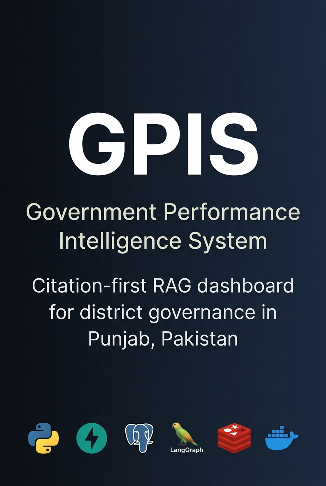
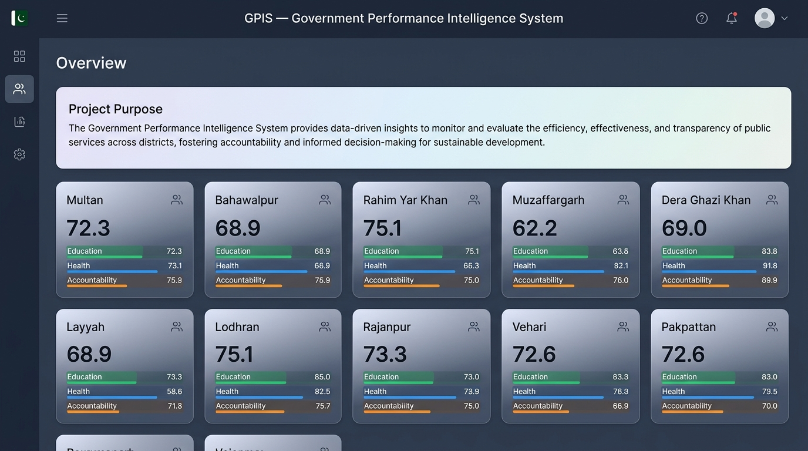
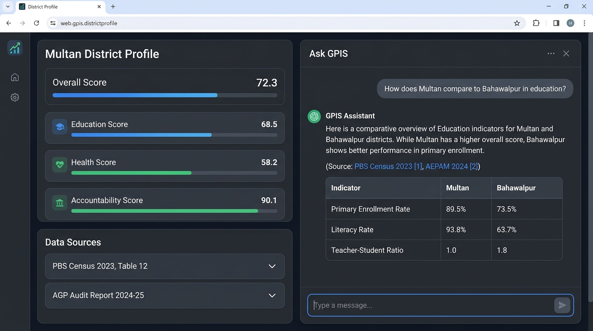

<p align="center">
  
</p>

<p align="center">
  <strong>Citation-first RAG dashboard for district governance in Punjab, Pakistan</strong>
</p>

<p align="center">
  <a href="https://github.com/HassanSardar525/GPIS/actions/workflows/ci.yml"></a>
  
  
  
  
</p>

# GPIS · Government Performance Intelligence System

GPIS helps citizens, journalists, and researchers compare Punjab’s 36 Census 2023 districts. Search for a district, compare a measure for the same reporting period, and open the government table behind it. District profiles also show who held office during a measurement period and where the historical record is incomplete.

**Release status.** The first release candidate has passed local acceptance and GitHub CI. The Render blueprint targets merged `main`. Hosted acceptance and production deployment are pending. [Release plan](PLANS.md) · [Release pull request](https://github.com/HassanSardar525/GPIS/pull/1)

## Explore a district

1. **Find Multan.** Search by name or use the Punjab map. Selecting a search result opens the profile with its population, education, health capacity, budget indicators, and score breakdown.
2. **Compare with Lahore.** Choose **Compare districts** and select Lahore. The Census 2023 total literacy row shows **61.41% for Multan** and **79.62% for Lahore**. Open the source beside either value to inspect PBS Table 12, cells `B1614` and `B1284` respectively. Rankings and charts provide the wider district context.
3. **Check who held office.** On the profile, **Who held office during this period?** aligns dated observations with provincial administrations. Select a tenure to inspect the observations it covers, or expand archived constituency records to see the office, area, date qualifications, and source. Overlap establishes who served during the period. Assigning personal credit or blame requires separate evidence.
4. **Ask a follow-up.** Ask GPIS carries the selected district into the question. Answers can include source passages, page or cell locators, and evidence previews. The interface identifies fallback answers and explains when evidence is insufficient. Sessions support follow-ups, expiry, starting over, and deletion.

## What the figures cover

| Area | Evidence and coverage |
|---|---|
| Education and population | PBS Census 2023 Tables 1 and 12 supply district population, literacy by sex, and out-of-school counts. A comparable earlier literacy series is awaiting review. |
| Public health capacity | Punjab Health Statistics Table 3 provides facility and bed observations. Four institution counts have comparable snapshots on **1 January and 31 December 2023** for all 36 districts. |
| District Health Authority spending | FY 2023–24 spending and grant utilization feed scores for all 36 districts. FY 2022–23 to FY 2023–24 development utilization can be compared for 17 South and 14 North authorities. Five North authorities have conflicting inputs. |
| Historical representation | The register contains 300 records, including seven chief-minister entries, three caretaker portfolio records, and 290 MPA entries from the 2018 Assembly’s **2021 publication**. Profiles distinguish this archived membership from verified service dates. |
| Source viewer | Citations open registered evidence, including highlighted workbook cells, PDF pages, source summaries, and calculated-score inputs. The release packages 56 original PDF page previews. |

The active `punjab-v1` score is the equal-weight mean of three measures covering literacy and gender inclusion, relative facility availability per 100,000 residents, and DHA budget utilization. These indicators describe specific aspects of district performance. Source conflicts, reporting periods, and missing inputs appear alongside the relevant figures. The original ten-district `prototype-v1` remains reproducible. [Scoring formulas](docs/PUNJAB_SCORING.md) · [Historical evidence and coverage](docs/HISTORICAL_EVIDENCE.md)

## 📸 Screenshots

<details>
<summary><strong>Overview — Punjab district map</strong></summary>
<br>

</details>

<details>
<summary><strong>District Profile — Scores, sources, and Ask GPIS chat</strong></summary>
<br>

</details>

<details>
<summary><strong>Compare & Trends — 36-district rankings and budget trends</strong></summary>
<br>

</details>

## Architecture and Ask GPIS


- **Data and scoring.** Python computes versioned scores and comparisons from reviewed observations. PostgreSQL/pgvector stores observations, scores, and searchable evidence. A JSON repository supports lightweight development and parity tests.
- **Document ingestion.** Separate, checksum-verified parsers read the PBS Table 12 workbook and the Punjab Health Statistics 2024 Table 3 PDF. They check district values against reviewed observations and produce 72 district rows plus six parent table or page records. Chat retrieves these stored passages with their source locations.
- **Retrieval and generation.** A bounded LangGraph agent can look up structured district facts, search official evidence, or consult project methodology. Hybrid search combines PostgreSQL full-text and MiniLM vector results using reciprocal rank fusion. Groq or Gemini can generate an explanation. Citation checks, extractive fallback, and abstention handle invalid citations, provider failures, and unsupported questions. Request checks also cover prompt injection and attempts to manipulate scores.
- **Sessions and operations.** FastAPI serves the HTML/CSS/JavaScript dashboard and versioned API. Pydantic validates API payloads, SQLAlchemy accesses PostgreSQL 16, and Alembic manages schema changes. PostgreSQL persists chat checkpoints. Redis optionally caches query embeddings and ranked evidence, with invalidation when the corpus changes. Optional Phoenix/OpenTelemetry spans support diagnostics. A separate LangSmith runner evaluates curated cases. Visitor chat disables inherited LangSmith tracing.

The interactive API documentation at [local Swagger UI](http://127.0.0.1:8000/docs) includes district profiles, census and score rankings, trends, history, officeholders, evidence, model selection, chat, sessions, and service health. [Architecture](docs/architecture.md) · [RAG design](docs/RAG_DESIGN.md)

## Quick start

Use Python 3.11 and Docker with Compose. From a fresh checkout of the release branch, run these PowerShell commands. The example environment points to the local Compose database and selects `punjab-v1`.

```powershell
git clone --branch feat/gpis-first-release https://github.com/HassanSardar525/GPIS.git
cd GPIS
python -m venv .venv
.\.venv\Scripts\Activate.ps1
python -m pip install -e ".[dev,browser,ingestion]"
Copy-Item .env.example .env
docker compose up -d --wait database redis
python -m alembic upgrade head
python -m app.cli bootstrap
python -m scripts.fetch_test_sources
python -m app.cli ingest-documents --source all
python -m app.server
```

Open the [local dashboard](http://127.0.0.1:8000). Bootstrap seeds observations and downloads the MiniLM model on first use to embed missing evidence. Source acquisition and document ingestion are separate steps. For live answers, set `GROQ_API_KEY` or `GEMINI_API_KEY` and the corresponding model in `.env` before starting the server. Extractive answers are available without a provider key. [Environment settings](.env.example)

To run the web service and its dependencies in containers, use `docker compose up --build`. Run the source acquisition and ingestion commands from the host checkout against the same database to enable document-backed retrieval. [Docker Compose configuration](compose.yml) · [Render blueprint](render.yaml)

## Verification

The full local suite passed **204 tests** with fresh PostgreSQL test databases and desktop and mobile browsers. The results below were recorded for the release through commit `a108d33`. [Verification record](PLANS.md) · [GitHub CI run](https://github.com/HassanSardar525/GPIS/actions/runs/44370418263)

| Level | What was verified |
|---|---|
| Component | Source extraction, routing, score formulas, district and period filters, and officeholder date matching. |
| Pipeline | **59 deterministic cases**, including all four required document cases. Routing, answer accuracy as measured by the fixture, recall at five, citation precision, and unsupported abstention each reached **100% on this set**. Separate checks exercised live Groq generation, document lookup, abstention, and a provider outage. |
| Application | Desktop (1,280px) and mobile (390px) browser checks followed the Multan–Lahore comparison through both source cells, archived representation, and a cited follow-up after switching districts. |

The hosted LangSmith experiment `gpis-curated-0496c07d` passed exact fact and citation checks on all six curated cases. The judge rated all six grounded and relevant. Its scores remain advisory pending independent human calibration. An earlier run caught an answer that gave the correct Lahore out-of-school count but cited an education score. The agent now checks for census evidence on that question.

```powershell
python -m pytest -q
python -m scripts.run_rag_evaluation --enforce --require-documents
python -m scripts.check_release --url http://127.0.0.1:8000
```

For the full suite, configure separate disposable legacy and Punjab test databases. For release acceptance, run the app with a live provider and install Chrome or Playwright Chromium. The release runner fails when a required browser or document check skips. Hosted experiments use `python -m scripts.run_curated_evaluation` with a candidate URL, revision, LangSmith key, and supported Groq judge model. [Testing commands and prerequisites](docs/testing.md)

## 📁 Project Structure

```text
app/
  agent.py        LangGraph agent, three tools, bounded calls and session memory
  services.py     District, cached retrieval and chat orchestration
  scoring.py      Deterministic score formulas
  cache.py        Failure-safe Redis cache-aside and corpus-version keys
  routing.py      Question classification and controlled query expansion
  llm.py          Groq and Gemini providers and citation validation
  embeddings.py   Local MiniLM embeddings
  document_ingestion.py  Checksum-verified workbook and PDF table ingestion
  history.py        Dated observations, officeholders, and evidence anchors
  punjab_scoring.py Punjab-wide scoring rules
  comparisons.py  Deterministic pairwise comparisons
  session_store.py PostgreSQL session lifecycle
  observability.py Optional Phoenix/OpenTelemetry spans
  main.py         FastAPI app and /api/v1 routes
  database/       SQLAlchemy models, repository, and seed
  static/         Browser UI (3 hash-routed views)
alembic/          Database migrations
data/evidence/    Packaged source previews
data/curated/     36-district scoring contract + retained pilot baseline and source snapshots
docs/             Architecture, methodology, RAG design, decisions, status
scripts/          Evaluation, documentation checks, session cleanup
tests/            Regression tests: API, scoring, RAG, agent, cache, sessions
```

## 📖 Documentation

| Document | Description |
|---|---|
| [Architecture](docs/architecture.md) | System diagram, modules, and API surface |
| [Punjab Scoring](docs/PUNJAB_SCORING.md) | Active 36-district formulas, periods and source conflicts |
| [Data & Scoring](docs/DATA_AND_SCORING.md) | Scoring methodology, formulas, and evidence contract |
| [RAG Design](docs/RAG_DESIGN.md) | Retrieval pipeline, guardrails, and evaluation |
| [Source Coverage](docs/SOURCE_COVERAGE.md) | Official sources, verified periods, and candidate decisions |
| [Project Scope](docs/PROJECT_SCOPE.md) | Problem statement, users, and non-goals |
| [Decisions](docs/DECISIONS.md) | Architecture decision records |
| [Release plan](PLANS.md) | Phase checklist, verification results and pending deployment |
| [Testing](docs/testing.md) | Database, browser, release and curated LangSmith checks |
| [Changelog](CHANGELOG.md) | Release history |

## 🤝 Contributing

Read the [contributor guide](AGENTS.md) and [conventions](docs/conventions.md) for phase branches, review, evidence requirements, and scoring rules.

## 📄 License

MIT. See [LICENSE](LICENSE).
