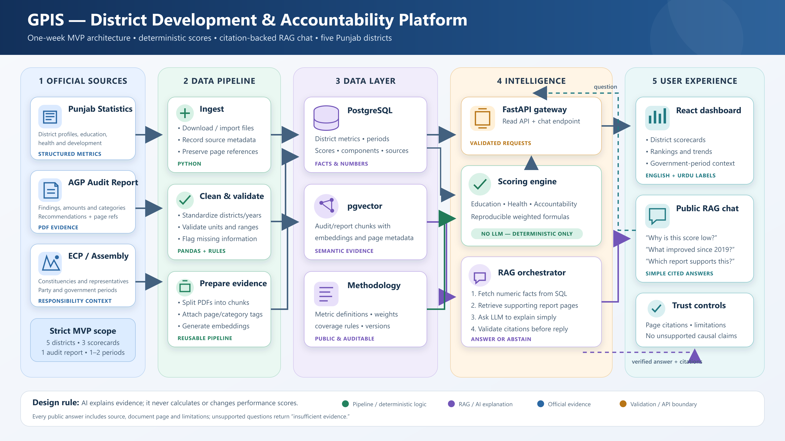

# Government Performance Intelligence System (GPIS)

GPIS is a citation-first district performance dashboard for South Punjab. It helps non-technical users compare education, health access, and public financial management using transparent scores linked to official evidence.

> Prototype status: working local MVP covering Multan, Bahawalpur, Rahim Yar Khan, Muzaffargarh, and Dera Ghazi Khan.



## What works now

- District search and scorecards.
- Five-district rankings by category and overall score.
- Deterministic, inspectable scoring rules.
- Source drill-down with document and page/table locators.
- Citation-grounded evidence assistant with abstention behavior.
- No external packages or API key required.

The retrieval layer explains existing evidence. It never calculates or changes a district score.

## Run locally

Requires Python 3.11 or newer.

```powershell
git clone <repository-url>
cd GPIS
python -m app.server
```

Open <http://127.0.0.1:8000>.

Run the test suite:

```powershell
python -m unittest discover -s tests -v
```

## Current evidence

- PBS Census 2023 Table 1: population denominator.
- PBS Census 2023 Table 12: literacy and out-of-school counts.
- Auditor-General audit report 2024-25: DHA facilities, audited coverage, and FY 2023-24 budget utilization.

Raw official documents are intentionally not stored in Git. The reviewed evidence contract used by the application is [`data/curated/districts.json`](data/curated/districts.json), and acquisition instructions are in [`data/raw/README.md`](data/raw/README.md).

## Important limits

- District conditions are not proof that a politician caused an outcome.
- Education is a literacy and gender-parity composite.
- Health is a relative facility-availability proxy, not care quality or health outcomes.
- Accountability is currently a budget-utilization proxy; high spending does not prove effective or honest spending.
- Scores compare only the five prototype districts and are not a Punjab-wide league table.

## Documentation

- [Project scope](docs/PROJECT_SCOPE.md)
- [Architecture](docs/ARCHITECTURE.md)
- [Data and scoring](docs/DATA_AND_SCORING.md)
- [RAG design](docs/RAG_DESIGN.md)
- [Current status](docs/STATUS.md)
- [Backlog](docs/BACKLOG.md)
- [Decision log](docs/DECISIONS.md)
- [Official document survey](docs/DOCUMENT_SURVEY.md)
- [Original one-week plan](plan.md)
- [Contributing guide](CONTRIBUTING.md)

## Direction

The prototype deliberately uses a standard-library server, reviewed JSON evidence, and lexical retrieval. The interfaces allow later replacement with FastAPI, PostgreSQL/pgvector, automated ingestion, and an LLM generator without moving score calculation into the model.

## License

MIT. See [LICENSE](LICENSE).
