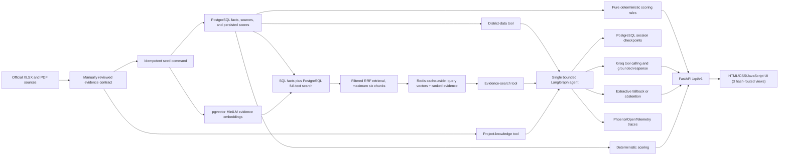

# Architecture

## Implemented architecture

The application has no runtime dependency on the raw documents. Reviewed values and evidence passages live in `data/curated/` with publisher, period, URL, and page/table locators.

## Modules

| Module | Responsibility |
|---|---|
| `app/scoring.py` | Calculate transparent category and overall scores |
| `app/agent.py` | Run the bounded LangGraph agent, three controlled tools, and session memory |
| `app/services.py` | Route questions, fuse and cache retrieval results, validate generation, and fall back safely |
| `app/cache.py` | Cache query vectors and ranked evidence with Redis, TTLs, hashed keys, corpus-version keys, and safe fallback |
| `app/session_store.py` | PostgreSQL-backed session lifecycle, sliding expiry, cleanup, and deletion |
| `app/observability.py` | Privacy-safe Phoenix/OpenTelemetry spans and no-op fallback |
| `app/comparisons.py` | Deterministic pairwise score, rank, component, and trend comparisons |
| `app/evidence_quality.py` | Typed evidence-quality contract with observation comparability and source anomalies |
| `app/score_quality.py` | Score reporting period, coverage, confidence, missing components, and warnings |
| `app/database/` | SQLAlchemy schema, repositories, idempotent seed, Alembic migrations, and embeddings |
| `app/llm.py` | Replaceable Groq provider and citation validator |
| `app/main.py` | FastAPI application, API contracts, errors, request IDs, and static UI |
| `app/routing.py` | Question classification and controlled query expansion |
| `app/embeddings.py` | Local MiniLM embeddings with lazy loading |
| `app/repositories.py` | JSON and PostgreSQL repository adapters with parity testing |
| `app/punjab_data.py` | PBS Census 2023 ingestion for 36 Punjab districts |
| `app/punjab_services.py` | Punjab-wide health and DHA budget fact services |
| `app/ingest_official_data.py` | Source-specific XLSX parser with checksum verification |
| `app/static/` | Three hash-routed views: Overview, District Profile + Ask GPIS, Compare & Trends |
| `data/curated/` | Versioned reviewed data contract |
| `tests/` | 19 test modules: scoring, agent, API, retrieval, comparisons, sessions, cache, census, evidence quality, browser, and more |
| `scripts/` | RAG evaluation, agent evaluation, markdown checks, session cleanup, Punjab services builder |

## API surface

- `GET /api/v1/health`
- `GET /api/v1/districts`
- `GET /api/v1/districts/{slug}`
- `GET /api/v1/districts/{slug}/trends/development-budget`
- `GET /api/v1/districts/{slug}/trends/health-capacity`
- `GET /api/v1/rankings?category={category}`
- `GET /api/v1/census-rankings?metric={metric}`
- `POST /api/v1/chat` — accepts optional `session_id`, returns `session_id`, `tools_used`, optional `comparison`
- `GET /api/v1/sessions/{session_id}` — session status
- `DELETE /api/v1/sessions/{session_id}` — permanent deletion with checkpoint cleanup

Dependency injection selects a PostgreSQL repository in normal operation and the curated JSON adapter for lightweight tests. The scoring engine has no FastAPI, database, embedding, or LLM dependency. Rankings query stored results rather than recalculating in handlers.
