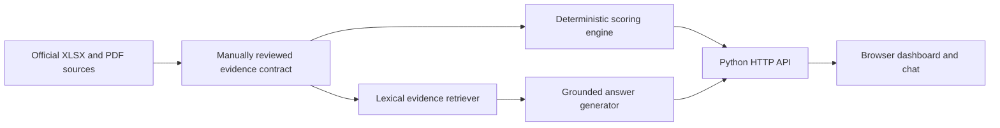
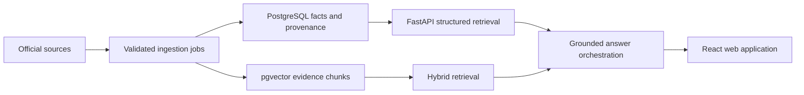

# Architecture

## Current prototype

The application has no runtime dependency on the raw documents. Reviewed values and evidence passages live in `data/curated/districts.json` with publisher, period, URL, and page/table locators.

## Modules

| Module | Responsibility |
|---|---|
| `app/scoring.py` | Calculate transparent category and overall scores |
| `app/retrieval.py` | Rank relevant evidence and generate citation-grounded answers |
| `app/server.py` | Serve JSON endpoints and static files |
| `app/static/` | District dashboard, rankings, evidence chat, and methodology UI |
| `data/curated/` | Versioned reviewed data contract |
| `tests/` | Score range, ranking, retrieval-scope, and abstention checks |

## API surface

- `GET /api/health`
- `GET /api/districts`
- `GET /api/districts/{slug}`
- `GET /api/rankings?category={category}`
- `POST /api/chat`

## Planned production-shaped replacement

The scoring engine remains separate from retrieval and generation. An LLM may explain retrieved facts, but it must not calculate, override, or silently reinterpret scores.
