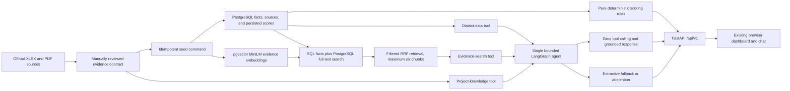

# Architecture

## Implemented architecture

The application has no runtime dependency on the raw documents. Reviewed values and evidence passages live in `data/curated/districts.json` with publisher, period, URL, and page/table locators.

## Modules

| Module | Responsibility |
|---|---|
| `app/scoring.py` | Calculate transparent category and overall scores |
| `app/agent.py` | Run the bounded LangGraph agent, three controlled tools, and in-memory chat sessions |
| `app/services.py` | Route questions, fuse retrieval results, validate generation, and fall back safely |
| `app/database/` | SQLAlchemy schema, repositories, idempotent seed, and embeddings |
| `app/llm.py` | Replaceable Groq provider and citation validator |
| `app/main.py` | FastAPI application, API contracts, errors, request IDs, and static UI |
| `app/static/` | District dashboard, ten-district rankings, two-period trends, score explanations, comparisons, and evidence chat |
| `data/curated/` | Versioned reviewed data contract |
| `tests/` | Score range, ranking, retrieval-scope, and abstention checks |

## API surface

- `GET /api/v1/health`
- `GET /api/v1/districts`
- `GET /api/v1/districts/{slug}`
- `GET /api/v1/districts/{slug}/trends/development-budget`
- `GET /api/v1/rankings?category={category}`
- `POST /api/v1/chat` accepts an optional `session_id` and returns `session_id` plus `tools_used`

Dependency injection selects a PostgreSQL repository in normal operation and the curated JSON adapter for lightweight tests. The scoring engine has no FastAPI, database, embedding, or LLM dependency. Rankings query stored results rather than recalculating in handlers.
